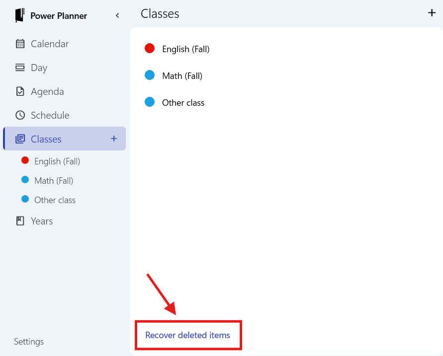
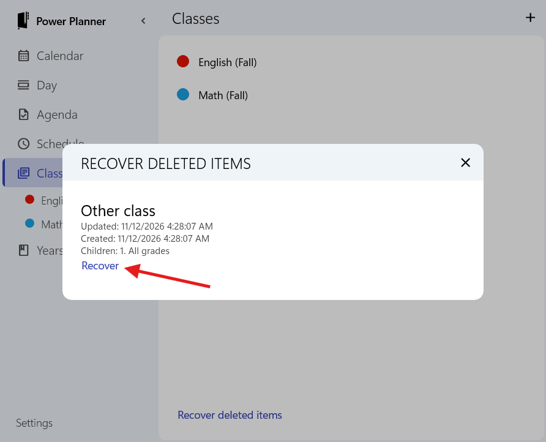

Did you accidentally delete a class? **If you had an online account**, you can restore your deleted class from your online backup.

While connected to the internet, from the Windows, Android, or iOS app (not supported on web app), go to the Classes page, scroll down to the bottom, and click the "Recover deleted items" button on the bottom right.

> Requires app version 2611.12 or greater. Check your app store for updates if you don't see this.

Then, you'll see the list of deleted classes. Click Recover on the one you want to recover.

Recovering will recover everything that was present at the time you deleted it. For example, all of the tasks, grades, and everything else under the class that was previously there will be restored too.