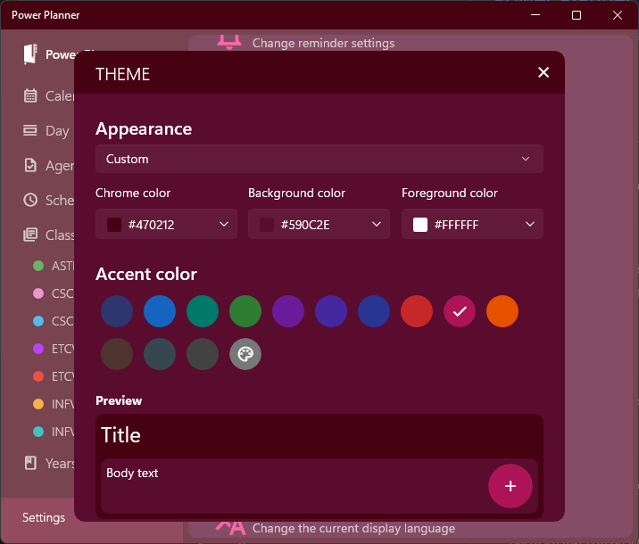

The iOS, Windows, and Android apps support picking a custom theme color for the app. Go to **Settings -> Theme**, and change the **Appearance** from **Automatic -> Custom**, and you can select custom background, foreground, and accent colors!

