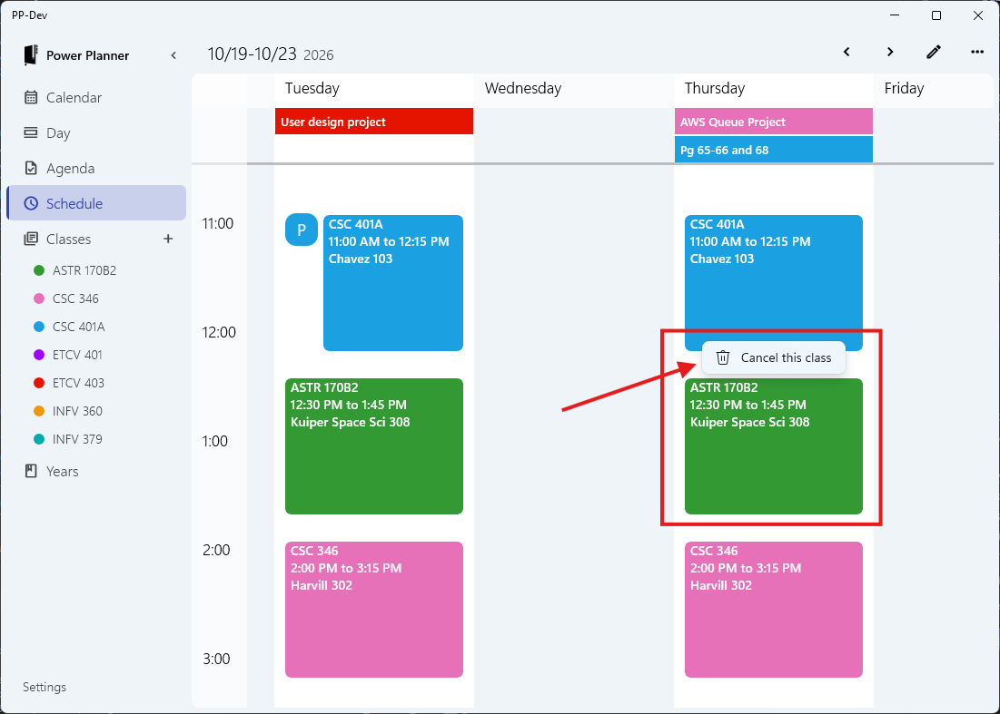
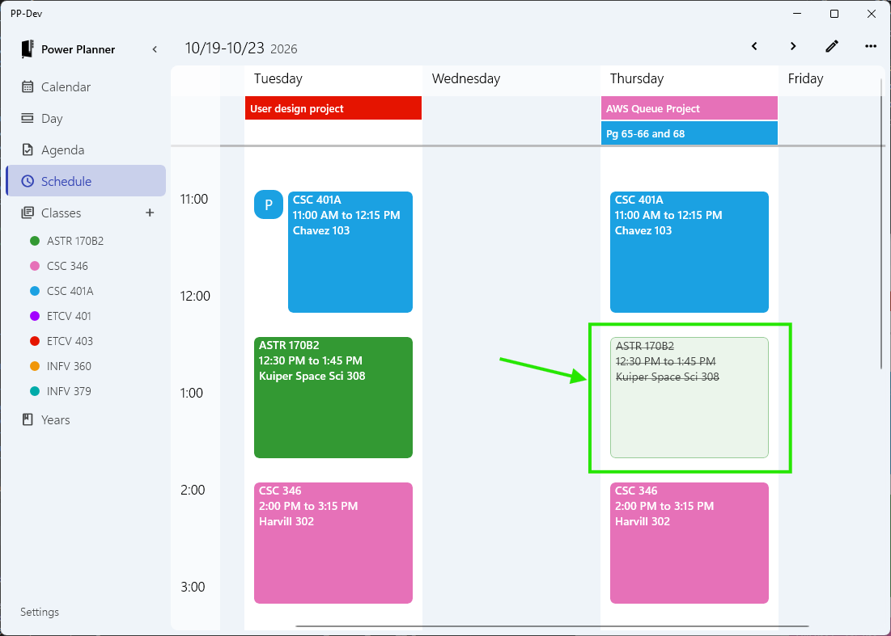

You can cancel a specific instance of a class, for example cancelling ASTR 170B2 class on Thursday Oct 22nd.

> This requires version 2610.23 of Power Planner. If you're not seeing this option, check the App Store for updates!

To cancel a class, go to the Schedule or Day view, locate the class time you're interested in cancelling on the visual schedule, and **right click or tap-to-hold** the class time entry, and click "Cancel this class".

After cancelling the class, it will still appear on your schedule, but greyed out and with a strikethrough. You can restore the class by right clicking it again.

