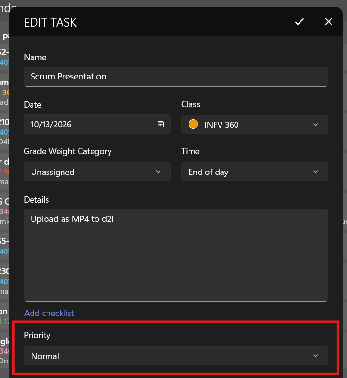
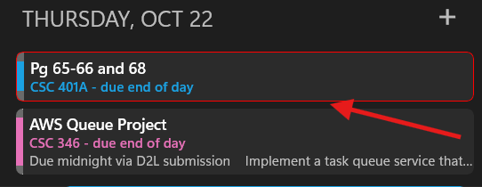

On each task or event, you can change the default priority from Normal to High or Low, to help you prioritize your items! This is available in version 2611.5 or greater of Power Planner on iOS, Android, and Windows.

When adding or editing a task or exam, scroll down and change the Priority field.

Setting a priority to high will visually highlight the item in list and calendar views, and moves it to the top of the list among items that are otherwise due at the same time.

A low priority item will move to the bottom of the list (among items that are due at the same time), and it will be slightly visually de-prioritized.